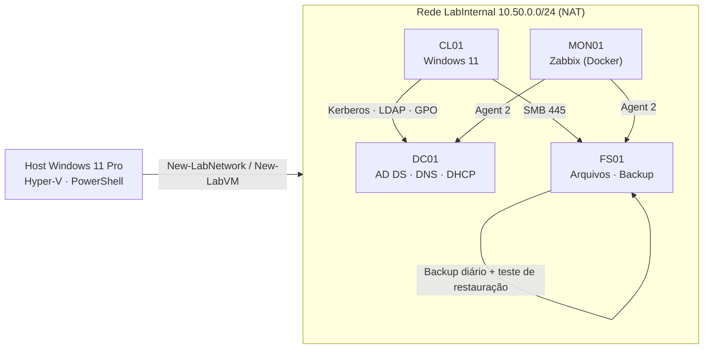

# Microsoft Infrastructure Labs

**Laboratório de infraestrutura Microsoft on-premises como código:** Windows Server, Active Directory, GPO, DNS/DHCP, servidor de arquivos, backup e restauração, monitoramento com Zabbix e segmentação de rede com FortiGate, tudo automatizado em PowerShell.

[Português](README.md) | [English](README.en.md)

[](https://github.com/matheuslab-bit/microsoft-infra-labs/actions/workflows/powershell-ci.yml)


Este repositório reproduz, num lab Hyper-V, o ambiente que um analista de infraestrutura sustenta no dia a dia de uma empresa. Cada lab tem objetivo, decisões técnicas justificadas, scripts idempotentes com `-WhatIf` e um checklist de validação.

> Portfólio Google Cloud (Terraform, IAP, GCS): [matheuslab-bit/google-cloud-portfolio](https://github.com/matheuslab-bit/google-cloud-portfolio)

## Labs

| # | Lab | O que demonstra |
| --- | --- | --- |
| 01 | [Ambiente Hyper-V](labs/01-hyperv-environment/README.md) | Rede interna isolada com NAT; VMs Geração 2 com Secure Boot e vTPM criadas a partir de um arquivo de configuração |
| 02 | [Active Directory](labs/02-active-directory/README.md) | Nova floresta com DNS integrado, OUs em camadas, carga de usuários via CSV com AGDLP e relatório de auditoria |
| 03 | [DNS e DHCP](labs/03-dns-dhcp/README.md) | Zona reversa, encaminhadores, scavenging, escopo DHCP autorizado e validação de faixa antes de aplicar |
| 04 | [Group Policy](labs/04-group-policy/README.md) | Política de senha e bloqueio, PSO para administradores, baseline de segurança das estações e backup versionado das GPOs |
| 05 | [Servidor de arquivos](labs/05-file-server/README.md) | Compartilhamentos departamentais, NTFS via grupos AGDLP e enumeração baseada em acesso |
| 06 | [Backup e recuperação](labs/06-backup-recovery/README.md) | Backup versionado com manifesto SHA256, **teste automatizado de restauração**, backup de estado do sistema e simulado da Lixeira do AD |
| 07 | [Monitoramento com Zabbix](labs/07-monitoring-zabbix/README.md) | Zabbix 7.0 LTS em Docker, Agent 2 com itens personalizados (replicação do AD, contas bloqueadas, idade do backup) |
| 08 | [FortiGate e VLANs](labs/08-fortigate-segmentation/README.md) | Segmentação em VLANs de servidores, estações e gerência, DHCP relay, matriz de acesso com menor privilégio e log do deny implícito |
| 09 | [Automação da operação](labs/09-operations-automation/README.md) | Relatório diário de saúde do AD, desligamento padronizado de colaboradores e higiene de contas inativas |

## Arquitetura do lab



## Práticas de engenharia

| Prática | Como é aplicada |
| --- | --- |
| Configuração como código | Rede, VMs, domínio, OUs, DHCP, compartilhamentos e backup vêm de um único arquivo, [`config/lab.psd1`](config/lab.psd1) |
| Idempotência | Os scripts verificam o estado atual e só alteram o que falta; podem rodar de novo com segurança |
| `-WhatIf` em tudo que altera | Todo script de mudança declara `SupportsShouldProcess`, e um teste garante isso |
| Segredos fora do código | Senhas pedidas como `SecureString`; `.env` fora do Git; nenhum segredo fixo, verificado em teste |
| Módulo compartilhado | [`modules/InfraLab`](modules/InfraLab) concentra log, leitura de configuração, nomes de login e cálculo IPv4, com testes unitários |
| Integração contínua | [GitHub Actions](.github/workflows/powershell-ci.yml): PSScriptAnalyzer, Pester no Ubuntu e no Windows e validação do `docker-compose` |
| Compatibilidade | Scripts em ASCII compatíveis com Windows PowerShell 5.1 (padrão do Windows Server) e PowerShell 7 |

## Estrutura

```text
.
├── config/lab.psd1            # definição única do lab
├── data/users.csv             # usuários fictícios para a carga em massa
├── modules/InfraLab/          # funções compartilhadas (testadas)
├── labs/01..09/               # um diretório por lab: README + scripts
├── tests/                     # Pester: unitários + qualidade dos scripts + consistência da configuração
└── .github/workflows/         # CI
```

## Como rodar os testes localmente

```powershell
Install-Module Pester -RequiredVersion 6.2.0 -Scope CurrentUser -SkipPublisherCheck
Install-Module PSScriptAnalyzer -RequiredVersion 1.25.0 -Scope CurrentUser
Invoke-Pester ./tests
Invoke-ScriptAnalyzer -Path ./labs -Recurse -Settings ./PSScriptAnalyzerSettings.psd1
```

## Status

| Lab | Código validado no CI | Executado no lab Hyper-V |
| --- | --- | --- |
| 01–09 | ✅ | Em andamento: cada README traz o checklist de validação |

Próximos passos no [ROADMAP](ROADMAP.md).

## Contato

- **GitHub:** [github.com/matheuslab-bit](https://github.com/matheuslab-bit)
- **LinkedIn:** [linkedin.com/in/matheus-s-ti](https://linkedin.com/in/matheus-s-ti)

---

*Ambiente de laboratório com dados fictícios. Os scripts aceitam `-WhatIf`: revise antes de executar em qualquer ambiente real.*
