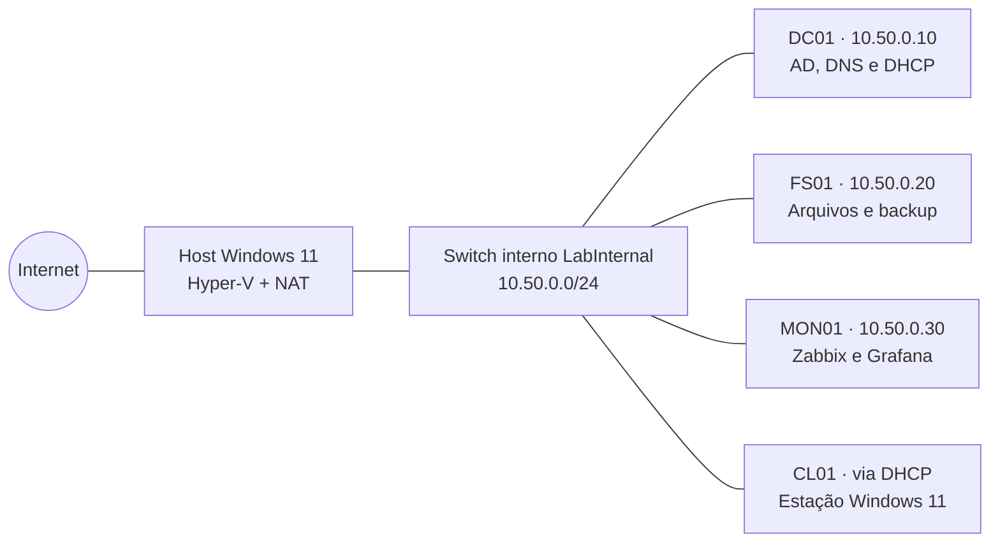

# Microsoft Infra Labs

O ambiente Microsoft de uma empresa, montado do zero num laboratório Hyper-V e automatizado com PowerShell: domínio, GPO, DNS, DHCP, servidor de arquivos, backup, monitoramento e firewall.

[Português](README.md) | [English](README.en.md)

## Em 30 segundos

- **10 labs** que constroem, em ordem, a infraestrutura de uma empresa pequena, cada um com um checklist para provar que funcionou.
- **Caixa de ferramentas** com os scripts que uso no atendimento: diagnóstico de rede, inventário, origem de bloqueio de conta.
- **Runbooks e checklists** escritos como numa base de conhecimento: o problema, a ordem de investigação e o comando pronto.
- **Tudo testado a cada mudança** no GitHub Actions (lint e testes no Windows e no Linux).

**Por onde começar:** [Lab 06 - Backup e recuperação](labs/06-backup-recovery/README.md), [Lab 08 - FortiGate e VLANs](labs/08-fortigate-segmentation/README.md) e o [runbook de conta bloqueando](docs/runbooks/conta-bloqueando.md).

## O ambiente

Quatro máquinas virtuais numa rede isolada, com saída para a internet pelo host:

No [lab 08](labs/08-fortigate-segmentation/README.md), essa rede plana é dividida em VLANs de servidores, estações e gerência, com o FortiGate controlando o que passa entre elas.

## Labs

| # | Lab | O que resolve |
| --- | --- | --- |
| 01 | [Ambiente Hyper-V](labs/01-hyperv-environment/README.md) | Cria a rede e as VMs a partir de um arquivo de configuração |
| 02 | [Active Directory](labs/02-active-directory/README.md) | Domínio, estrutura de OUs e usuários criados em massa por CSV |
| 03 | [DNS e DHCP](labs/03-dns-dhcp/README.md) | Nomes resolvendo e IPs entregues automaticamente |
| 04 | [Group Policy](labs/04-group-policy/README.md) | Política de senha, regra mais rígida para a TI e segurança das estações |
| 05 | [Servidor de arquivos](labs/05-file-server/README.md) | Pastas por departamento, com acesso por grupo (AGDLP) |
| 06 | [Backup e recuperação](labs/06-backup-recovery/README.md) | Backup com conferência de hash e teste de restauração |
| 07 | [Monitoramento com Zabbix](labs/07-monitoring-zabbix/README.md) | Alertas de AD, backup e servidores, com template pronto |
| 08 | [FortiGate e VLANs](labs/08-fortigate-segmentation/README.md) | Rede separada em VLANs, com regras de acesso entre elas |
| 09 | [Automação do dia a dia](labs/09-operations-automation/README.md) | Relatório de saúde do AD, desligamento de colaborador, contas paradas |
| 10 | [Dashboards no Grafana](labs/10-grafana-dashboards/README.md) | Painel de infraestrutura que já sobe configurado |

**Situação:** os scripts estão prontos e passam no CI. A execução de cada lab no meu Hyper-V está em andamento: um lab só é marcado como concluído quando o checklist do fim do README dele estiver completo.

## Além dos labs

| Pasta | O que tem |
| --- | --- |
| [`toolkit/`](toolkit/README.md) | Scripts `.bat`, PowerShell e Linux para o atendimento, que rodam em qualquer máquina. Testados num Windows 11 |
| [`docs/`](docs/README.md) | Runbooks de troubleshooting, checklists (entrada e saída de colaborador, servidor novo, mudança, filial nova) e guias |
| [`automacao-js/`](automacao-js/README.md) | Três automações em Node.js: relatório de SLA dos chamados, vencimento de certificados e saúde de serviços web |

## Como o código funciona

- **Uma configuração só.** IPs, nomes, domínio e pastas ficam em [`config/lab.psd1`](config/lab.psd1). Para mudar o ambiente, muda-se um arquivo.
- **Pode rodar de novo sem quebrar.** Cada script confere o que já existe e só cria o que falta.
- **Simula antes de fazer.** Todo script que altera algo aceita `-WhatIf`.
- **Nenhuma senha no código.** As senhas são pedidas na hora.
- **Testado a cada push:** PSScriptAnalyzer, Pester no Windows e no Ubuntu, `node --test`, ShellCheck e validação dos `docker-compose`.

## Próximos passos

Executar os labs no Hyper-V com prints de cada resultado e, depois, os próximos labs (atualizações, identidade híbrida com Entra ID, Intune, segundo DC e rastreabilidade). Detalhes no [ROADMAP](ROADMAP.md).

## Sobre mim

Trabalho com TI desde 2014. Administrei o Active Directory de um contact center com cerca de 2.000 posições de atendimento, com GPO, Hyper-V, backup e FortiGate. Monitorei redes de clientes corporativos com Zabbix e PRTG. Hoje sou analista N2 de telecom e VoIP. Meus labs de nuvem ficam no [google-cloud-portfolio](https://github.com/matheuslab-bit/google-cloud-portfolio).

[LinkedIn](https://linkedin.com/in/matheus-s-ti) · [matheus.silva.gcp@gmail.com](mailto:matheus.silva.gcp@gmail.com)

---

Laboratório com dados fictícios. Antes de usar um script num ambiente real, rode com `-WhatIf` e revise.
