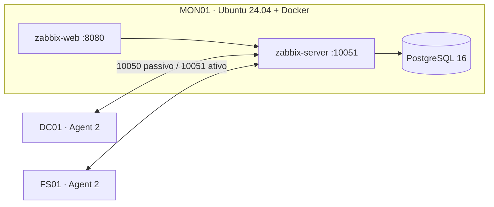

# Lab 07 — Monitoramento com Zabbix

Monitoramento proativo do ambiente: o alerta chega antes do usuário ligar reclamando.

## Arquitetura



## O que é monitorado

| Item | Origem | Gatilho sugerido |
| --- | --- | --- |
| CPU, memória e disco | Template *Windows by Zabbix agent active* | Disco livre < 15% |
| Serviços críticos (NTDS, DNS, Netlogon, KDC, DHCPServer) | `service.info[...]` | Serviço parado |
| Falhas de replicação do AD | `ad.replication.failures` (personalizado) | > 0 |
| Contas bloqueadas | `ad.users.locked` (personalizado) | Pico fora do normal (possível ataque de senha) |
| Idade do último backup | `lab.backup.age.days` (personalizado) | > 1 dia |
| Eventos de segurança | `eventlog[Security,,,,4740]` | Conta bloqueada (evento 4740) |

## Como executar

```bash
# MON01
cd labs/07-monitoring-zabbix
cp .env.example .env   # definir senha forte
docker compose up -d   # interface em http://10.50.0.30:8080
```

```powershell
# DC01 / FS01
.\Install-LabZabbixAgent.ps1 -MsiPath C:\Temp\zabbix_agent2-7.0-windows-amd64-openssl.msi
```

No Zabbix: **Alerts → Actions → Autoregistration** com condição `Host metadata contains windows-lab` para adicionar o host e vincular o template automaticamente.

## Decisões técnicas

- **Zabbix 7.0 LTS em contêineres:** sobe e é recriado em minutos; dados persistem no volume do PostgreSQL.
- **Senhas fora do Git:** `.env` está no `.gitignore`; só o `.env.example` é versionado.
- **Firewall restrito:** a porta 10050 do agente aceita apenas o IP do MON01.
- **Autorregistro por metadata:** um servidor novo entra no monitoramento sem cadastro manual.

## Validação

- [ ] Hosts DC01 e FS01 com disponibilidade verde (ZBX)
- [ ] `zabbix_get -s 10.50.0.10 -k ad.replication.failures` retorna `0`
- [ ] Parar o serviço DNS no DC01 gera alerta em até 1 minuto
