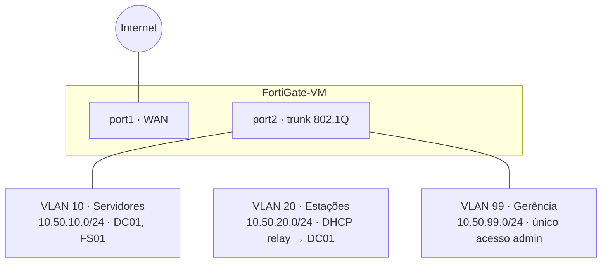

# Lab 08 — Segmentação de rede com FortiGate e VLANs

Evolui o lab de rede plana para um desenho segmentado, como numa empresa: servidores, estações e gerência em VLANs separadas, com o FortiGate controlando o tráfego entre elas.

## Desenho

## Matriz de acesso

| # | Origem → Destino | Serviços | Observação |
| --- | --- | --- | --- |
| 10 | Estações → DC01 | DNS, Kerberos, LDAP, NTP, SMB, RPC | Somente o necessário para logon e GPO |
| 20 | Estações → FS01 | SMB 445 | Acesso a arquivos |
| 30 | Estações → Internet | HTTP, HTTPS, DNS | NAT + filtro web + antivírus |
| 40 | Servidores → Internet | HTTP, HTTPS, DNS, NTP | Atualizações |
| 50 | Gerência → todas | Tudo | Administração |
| 0 | Qualquer outro | — | **Negado e registrado em log** (deny implícito) |

## Boas práticas aplicadas

- **Menor privilégio entre VLANs:** estação não fala com estação nem acessa porta de gerência de servidor.
- **Administração só pela VLAN 99:** `trusthost` no usuário admin, HTTPS em porta alternativa e bloqueio após 3 tentativas.
- **DHCP relay:** um único servidor DHCP (DC01) atende várias VLANs.
- **Log de tudo,** inclusive do deny implícito, para troubleshooting e auditoria.
- Objetos e grupos de serviço com nomes padronizados (`net-`, `host-`, `grp-`).

## Como usar

1. Importar a FortiGate-VM no Hyper-V (a licença de avaliação permanente está disponível no portal da Fortinet).
2. Colar o [`fortigate-baseline.conf`](fortigate-baseline.conf) por seções na CLI.
3. Adicionar as VLANs 10, 20 e 99 aos adaptadores das VMs: `Set-VMNetworkAdapterVlan -VMName CL01 -Access -VlanId 20`.

## Validação

- [ ] CL01 (VLAN 20) recebe IP via relay e faz logon no domínio
- [ ] CL01 **não** acessa a interface HTTPS do FortiGate
- [ ] O log mostra o tráfego negado entre VLANs no deny implícito
